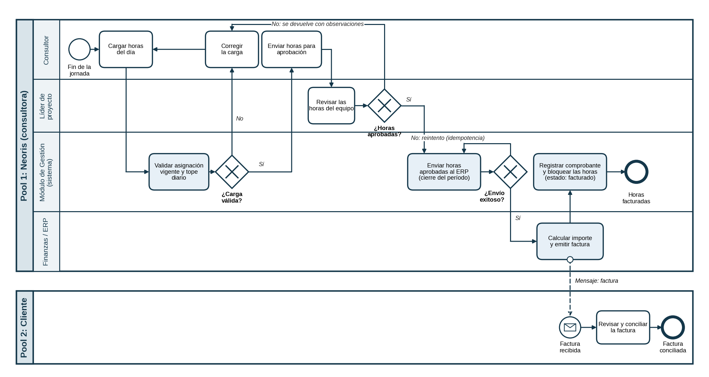

# Sistema de Gestión de Proyectos y Recursos — Neoris

**Trabajo Práctico Integrador y Progresivo (TPI)** · Organización Empresarial
Tecnicatura Universitaria en Programación (a distancia) · Universidad Tecnológica Nacional

## Descripción del sistema

Módulo interno de **Gestión de Proyectos y Recursos** para Neoris, una consultora de transformación digital y desarrollo de software. Permite asignar consultores a proyectos, registrar y aprobar las horas trabajadas y enviar las horas aprobadas al ERP para facturarlas, con trazabilidad y sin doble facturación.

Este repositorio aloja la **documentación técnica** del proyecto; todavía no contiene código.

## Integrantes

| Integrante | Comisión |
|---|---|
| Lucas Solhaune | Comisión 4, R – Rosario |

**Docente titular:** Gabriela Martínez · **Docente tutor:** Roberto Fabián Regner

## Enlaces

- Tablero de gestión (GitHub Projects): https://github.com/users/lucassolhaune/projects/3/views/1

## Contenido

| Ruta | Descripción |
|---|---|
| `docs/entregas/` | Entregas 1, 2, 3 y 4 del TPI (PDF) |
| `docs/bpmn/` | Diagrama BPMN del proceso de registro, aprobación y facturación de horas |
| `docs/diccionario-de-datos.md` | Entidades y campos del módulo |
| `docs/historias-de-usuario.md` | Las tres historias de usuario y sus criterios de aceptación |
| `docs/indicadores-de-control.md` | Indicadores de control y estándares de desempeño |
| `docs/flujo-de-trabajo.md` | Ramas, mensajes de commit y Pull Requests |

## Flujo de trabajo

La rama `main` contiene la versión estable. Cada tema se trabaja en una rama `docs/...`, con commits descriptivos (`tipo: descripción en imperativo`) y, para los cambios importantes, un Pull Request revisado por otra persona. Detalle en [`docs/flujo-de-trabajo.md`](docs/flujo-de-trabajo.md).

## Declaración de Uso de IA

Se usó **Claude (Anthropic, Claude Sonnet 5.5)** como asistente en la elaboración de las entregas 2, 3 y 4 y de este repositorio.

### Prompts utilizados y justificación

| Prompt (resumen) | Para qué | Por qué así / qué se corrigió |
|---|---|---|
| Armar la Entrega 2 con la consigna y la Entrega 1 adjuntas | FODA, objetivos, metas y Gantt | Se adjuntó la Entrega 1 como contexto para que la IA no inventara datos del caso. |
| Armar la Entrega 3 y auditarla | Organigrama y diccionario de datos | La auditoría detectó tablas cortadas, una fuente distinta y una referencia con título inventado; se corrigieron. |
| Dar un tono más personal y revisar las referencias | Redacción y bibliografía | Se cuestionó la validez de las referencias; quedó pendiente sumar bibliografía de la cátedra. |
| Seguir con la Entrega 4 con la consigna adjunta | BPMN, README, historias de usuario, indicadores | La IA no puede crear el repositorio ni el tablero: eso se hizo a mano en GitHub. |

### Correcciones humanas sobre los resultados de la IA

A partir de los resultados iniciales proporcionados por la IA, se ejecutaron las siguientes correcciones y mejoras manuales:

* **Reestructuración del diagrama BPMN:** Ordenamiento lógico de los elementos y flujos para reflejar de manera precisa el proceso.
* **Corrección de estilo y texto:** Corrección de errores ortográficos, gramaticales y de formato en la redacción de las Historias de Usuario.
* **Optimización de legibilidad:** Estructuración y maquetación general del texto para lograr un documento claro y bien organizado.

### Responsabilidad

La asistencia de IA no exime de la veracidad del contenido: los errores del modelo son responsabilidad del autor. La estructura organizacional y los datos del diccionario son propuestas hipotéticas y no corresponden a información interna de Neoris.
